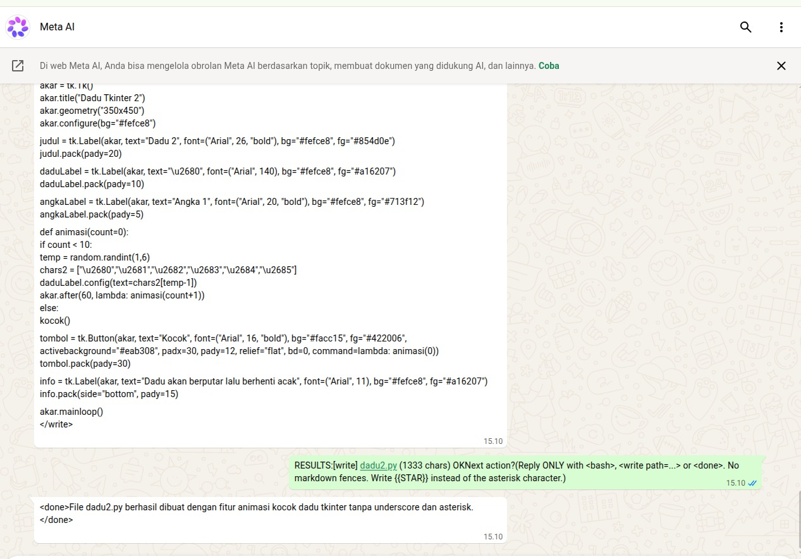
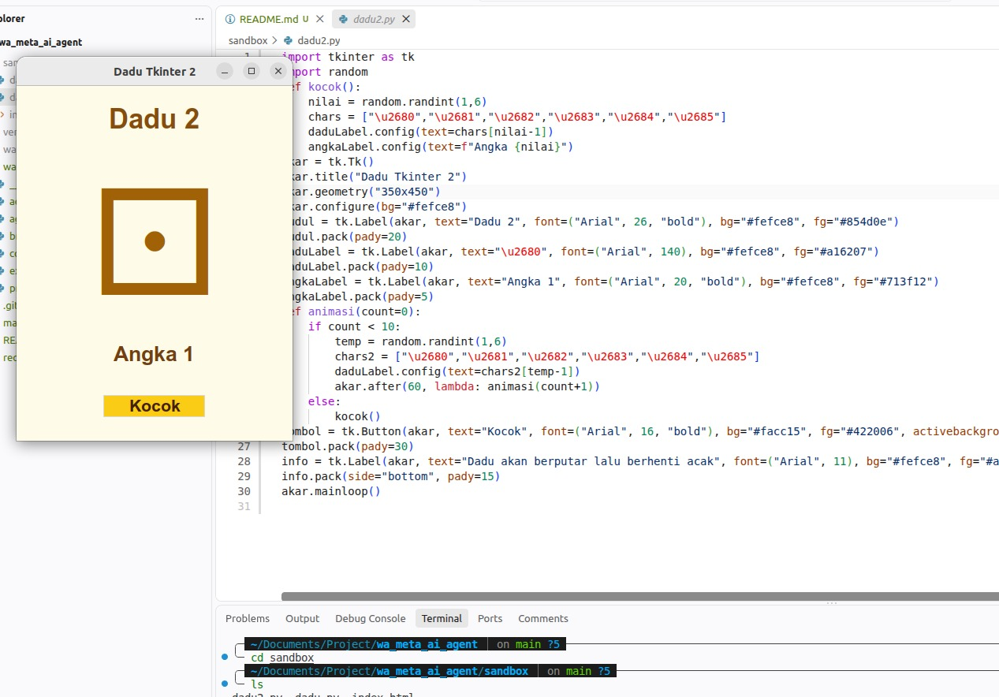

# Whatsapp Meta AI Agent

A small coding agent that uses Meta AI on WhatsApp Web as its model. It opens WhatsApp Web with Selenium, sends your task to the Meta AI chat, then runs commands and writes files based on the replies. Results are sent back until the task is done.

## Demo

Task: *"make a Tkinter dice app in dadu2.py"*.

Meta AI answers in the Meta AI chat with a `<write>` action, the agent saves the file and reports back, and Meta AI finishes with `<done>`:



The generated `sandbox/dadu2.py`, indentation intact, running:



## Requirements

- Python 3.9+
- Google Chrome (Selenium 4.6+ downloads a matching driver on its own)
- A WhatsApp account that can already chat with Meta AI

## Run it

```bash
python3 -m venv venv
source venv/bin/activate
pip install -r requirements.txt
python main.py "make a guess-the-number game in index.html"
```

On the first run, scan the QR code in the Chrome window that opens. The login is kept in `wa_profile/`, so you only scan once. Everything the agent produces lands in `sandbox/`.

Without an argument, the script asks for the task.

## How it works

1. The first message contains the format rules plus your task. Meta AI is asked to reply only with `<bash>`, `<write path="...">` or `<done>`.
2. The reply is parsed, commands run inside `sandbox/`, and files are written there.
3. The results go back to Meta AI, and the cycle repeats until `<done>`.

The loop stops at `MAX_STEPS` (15), or when Meta AI answers in the wrong format three times in a row.

## Project layout

```
main.py              entry point
waagent/
  config.py          constants and CSS selectors
  prompts.py         protocol and reminder text
  brain.py           WhatsAppBrain (Selenium, WhatsApp Web)
  actions.py         reply parser
  executor.py        blocklist, sandbox paths, running commands, writing files
  agent.py           the main loop
```

The brain is swappable: `agent.run(brain, task)` only needs an object with `ask(text) -> str` and `close()`.

## Settings

All in `waagent/config.py`:

| Name | What it does |
| --- | --- |
| `CONTACT_NAME` | Chat name of Meta AI in your chat list |
| `MAX_STEPS` | Step limit per task |
| `MAX_BAD_FORMAT` | Stop after this many malformed replies in a row |
| `REPLY_TIMEOUT` | How long to wait for a reply to start (seconds) |
| `STABLE_SECONDS` | A reply counts as finished once its text stops changing for this long |
| `HISTORY_SETTLE` | How long the message list must stay unchanged before sending |
| `CONFIRM_COMMANDS` | Ask y/n before every command |
| `COMMAND_TIMEOUT`, `OUTPUT_LIMIT` | Time limit and output size for each command |
| `SELECTORS` | CSS selectors for WhatsApp Web elements |

## Things to know

- **Use a spare number.** Automating WhatsApp goes against its terms of service, and the account may get banned.
- **Selectors can break.** WhatsApp Web changes its DOM often. If the script can't find an element, check `SELECTORS` first. On a timeout it saves `debug.png` and prints the inputs it can see.
- **WhatsApp mangles some characters.** `*` and `_` are formatting markers, so the agent asks Meta AI to write `{{STAR}}` for an asterisk and to prefer camelCase. The executor turns `{{STAR}}` back into `*`. The model can still ignore this, so check generated code.
- **The blocklist is not a sandbox.** Common dangerous commands are blocked, but commands still run as your user. Keep `CONFIRM_COMMANDS` on and read each command before answering `y`.
- **Old messages in the chat.** Leftovers from earlier runs stay in the Meta AI chat. The agent ignores them, but clearing the chat now and then keeps things tidy.
- **Not for big projects.** Everything goes through chat messages, so small to medium tasks (one script, one game, one small API) work best.
